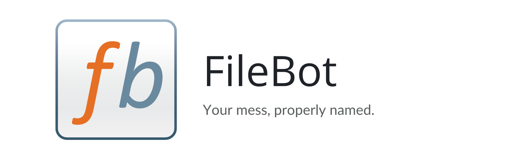
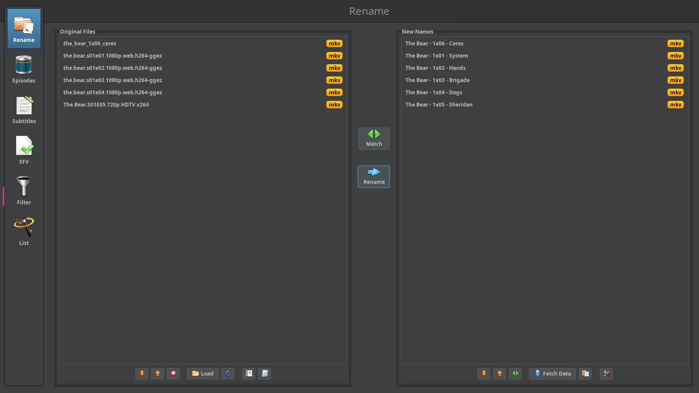
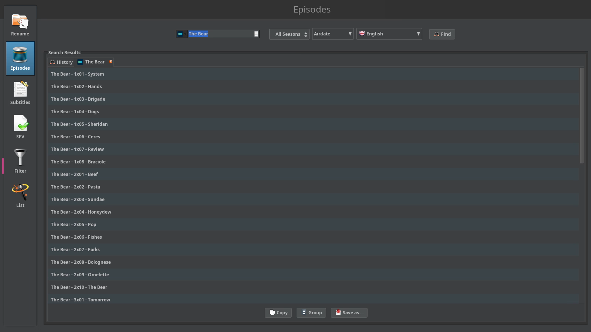

<p align="center">
  <picture>
    <source media="(prefers-color-scheme: dark)" srcset="https://raw.githubusercontent.com/junkerderprovinz/filebot/main/.github/assets/filebot-banner-dark.png">
    
  </picture>
</p>

<p align="center">
  <a href="https://github.com/junkerderprovinz/filebot/actions/workflows/build.yml"></a>&nbsp;
  <a href="https://github.com/junkerderprovinz/filebot/actions/workflows/lint.yml"></a>&nbsp;
  <a href="https://hub.docker.com/r/junkerderprovinz/filebot"></a>&nbsp;
  <a href="https://hub.docker.com/r/junkerderprovinz/filebot"></a>&nbsp;
  <a href="https://github.com/junkerderprovinz/filebot/pkgs/container/filebot"></a>&nbsp;
  <a href="https://www.filebot.net/"></a>&nbsp;
  <a href="https://ca.unraid.net/apps?q=filebot"></a>&nbsp;
  <a href="LICENSE"></a>
</p>

<p align="center">
<b>FileBot, in your browser.</b> Rename movies, shows and music from any device. No VNC client, no local install.<br>
This runs the full FileBot desktop app inside a single container and streams it to your browser over <a href="https://github.com/selkies-project/selkies">Selkies</a> (H.264 video), so scrolling through a season's worth of files and dragging them around feels like a local window.
</p>

<!-- download-buttons: written by scripts/gen_download_buttons.py -->
<p align="center">
  <a href="https://ca.unraid.net/apps?q=filebot"></a>
  &nbsp;
  <a href="https://hub.docker.com/r/junkerderprovinz/filebot/"></a>
  &nbsp;
  <a href="https://github.com/junkerderprovinz/filebot/releases/latest"></a>
</p>
<!-- /download-buttons -->

<br>

<p align="center">
A one-knight job: I build it, keep it running, work through the issues and add what people ask for, until nothing is missing. It is free, with no accounts, no telemetry, no ads and no paid tier. No asterisk anywhere. Nothing readable ever leaves your own walls. Forged on evenings and weekends, with heart and stubbornness.
</p>

<p align="center">
If it has earned a place on your server or computer, toss a coin to your knight: it helps cover the costs and keeps the project alive. It also makes this knight's heart beat a little faster. Three ways below, whichever suits you.
</p>

<!-- give-buttons: written by scripts/gen_download_buttons.py -->
<p align="center">
  <a href="https://buymeacoffee.com/junkerderprovinz"></a>
  &nbsp;
  <a href="https://www.paypal.com/donate/?hosted_button_id=76FVV52TKXTUS"></a>
  &nbsp;
  <a href="https://junkerderprovinz.github.io/junkerderprovinz/"></a>
</p>
<!-- /give-buttons -->

<br>

## Table of Contents

1. [What it looks like](#1-what-it-looks-like)
2. [What it does](#2-what-it-does)
3. [Getting started](#3-getting-started)
4. [Your FileBot license](#4-your-filebot-license)
5. [How AI is used here](#5-how-ai-is-used-here)
6. [Support this project](#6-support-this-project)

<br>

## 1. What it looks like

<p align="center">
  
  <br><em>Six messy file names matched against TheMovieDB, one click before they are renamed</em>
</p>

<p align="center">
  
  <br><em>The Episodes panel looks up a whole series, season by season</em>
</p>

<br>

## 2. What it does

- **The real program.** This is the FileBot desktop app itself, installed unmodified from FileBot's own package repository and updated with every weekly build. Rename, Episodes, Subtitles, SFV, Filter and List all work as they do on a desktop.
- **Everything FileBot needs to match well.** MediaInfo, chromaprint for AcoustID music matching, 7-Zip and unrar for archives, mkvtoolnix, AtomicParsley and ffmpeg come along, the same helpers the official FileBot images carry.
- **Dark from the first start.** FileBot opens in its Darcula theme, and the file dialogs follow. For another theme, set `net.filebot.theme` in `/config/filebot/system.properties`, or `FILEBOT_THEME` before the first start.
- **The whole tab for FileBot.** The main window fills the browser tab without a title bar of its own. Dialogs keep theirs, open at their own size, and the file dialogs begin in `/storage`, the folder you map your media to.
- **Titles in your language.** FileBot's own interface is English only, but episode and movie titles come in whatever language you pick in its language menu, German included.
- **Back on its own.** Close FileBot by accident and it starts again within a few seconds, without a container restart.
- **Nothing lost on updates.** Your license, settings, history and cache live under `/config/filebot`.

<br>

## 3. Getting started

On Unraid, install **FileBot** from [Community Applications](https://ca.unraid.net/apps?q=filebot). Anywhere else, one container is enough:

```sh
docker run -d --name filebot -p 3001:3001 --shm-size=1gb \
  -e PUID=99 -e PGID=100 \
  -v /path/to/config:/config \
  -v /path/to/media:/storage \
  junkerderprovinz/filebot:latest
```

Then open `https://<server>:3001` and accept the self-signed certificate once. Your media is under `/storage` in every file dialog.

> [!NOTE]
> The WebUI has no login by default, for use on a trusted LAN. Set `CUSTOM_USER` and `PASSWORD` to turn on the built-in login, and never expose the WebUI to the internet without a VPN or an authenticating reverse proxy in front.

<br>

## 4. Your FileBot license

FileBot is commercial software by Reinhard Pointner, and renaming needs a license from [filebot.net](https://www.filebot.net/purchase.html). This image ships none. It installs FileBot as it comes, and you bring your own key, the same as on a desktop.

Pick whichever way of activating it suits you:

- **Drop it in.** Put the `license.txt` you got from FileBot into the container's `/config` folder (on Unraid, the appdata folder) and restart. The container activates it once and renames the file to `license.txt.activated`.
- **From the app.** Without a license, FileBot's Rename button offers Paste License Key and Select License File.
- **From a shell.** `docker exec -it -u abc filebot filebot --license /config/license.txt`

If you move over from another FileBot container, copy its `license.psm` into `/config/filebot/` and FileBot finds it on the next start. The settings in `prefs.properties` and the rename history in `history.xml` can come along the same way.

<br>

## 5. How AI is used here

One knight builds this, and AI is one of the tools I work with, the same way I work with an editor or a compiler. It helps me write code and documentation and it checks my work, and that saves me a good many evenings. It does not make the decisions, though. I read and understand everything before it ships, and if something here breaks, that is on me and not on the tool.

You do not have to take my word for it. The code is open and every release note is written by hand. The issue tracker shows how problems actually get handled, including the ones I got wrong the first time. If you find something that is not right, open an issue and I will look at it.

<br>

## 6. Support this project

Questions, bugs, ideas or feature requests? Please [open a GitHub issue](https://github.com/junkerderprovinz/filebot/issues). A question about FileBot itself, its formats or its license is best asked in the [FileBot forum](https://www.filebot.net/forums/).

A one-knight job: I build it, keep it running, work through the issues and add what people ask for, until nothing is missing. It is free, with no accounts, no telemetry, no ads and no paid tier. No asterisk anywhere. Nothing readable ever leaves your own walls. Forged on evenings and weekends, with heart and stubbornness.

If it has earned a place on your server or computer, toss a coin to your knight: it helps cover the costs and keeps the project alive. It also makes this knight's heart beat a little faster. Three ways below, whichever suits you.

<!-- give-buttons: written by scripts/gen_download_buttons.py -->
<p align="center">
  <a href="https://buymeacoffee.com/junkerderprovinz"></a>
  &nbsp;
  <a href="https://www.paypal.com/donate/?hosted_button_id=76FVV52TKXTUS"></a>
  &nbsp;
  <a href="https://junkerderprovinz.github.io/junkerderprovinz/"></a>
</p>
<!-- /give-buttons -->

<br>

<sub>[FileBot](https://www.filebot.net/) is commercial software by Reinhard Pointner, and this project is not affiliated with or endorsed by it. The FileBot name and logo belong to their owner and are used here only to name the application this image packages. The packaging here is AGPL-3.0; see [LICENSE](LICENSE) and [NOTICE](NOTICE) for the bundled software.</sub>
